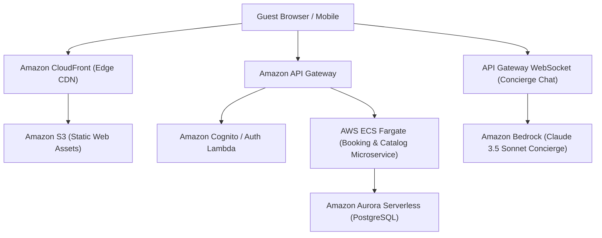

# AtithiFusion — Luxury Hospitality Portal & Conversational AI Concierge

> Responsive hospitality marketplace featuring real-time property listings, booking workflows, and an intelligent budget-aware reservation assistant.

---

## 1. Executive Brief
Modern vacation rental experiences demand frictionless search and instant conversational assistance. **AtithiFusion** pairs an editorial luxury grid layout with an embedded AI concierge capable of answering property queries, recommending local itineraries, and filtering listings by dynamic budgetary constraints.

* **Preservation**: Original Airbnb clone baseline preserved on [`Ex`](https://github.com/prak05/AtithiFusion-Hospitality-Portal/tree/Ex).
* **Architecture**: CloudFront + S3 static hosting, ECS Fargate backend, and Amazon Bedrock concierge agent.

---

## 2. AWS Cloud Architecture

---

## 3. Branch Architecture
* [`main`](https://github.com/prak05/AtithiFusion-Hospitality-Portal/tree/main): Modernized hospitality portal with CloudFront CDN and Bedrock agent.
* [`Ex`](https://github.com/prak05/AtithiFusion-Hospitality-Portal/tree/Ex): Preserved original frontend baseline.

<!-- antigravity-certified -->
